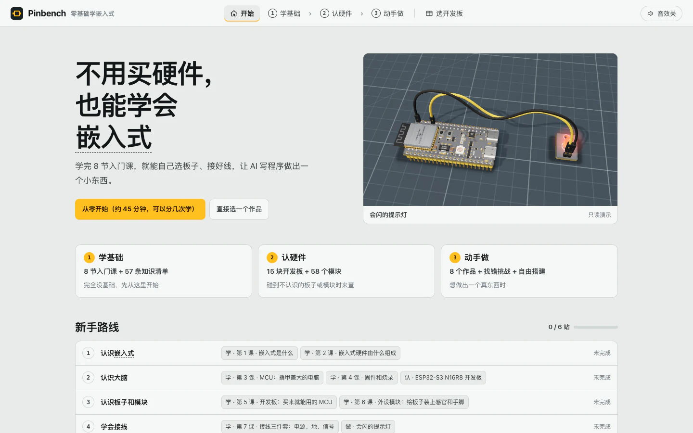
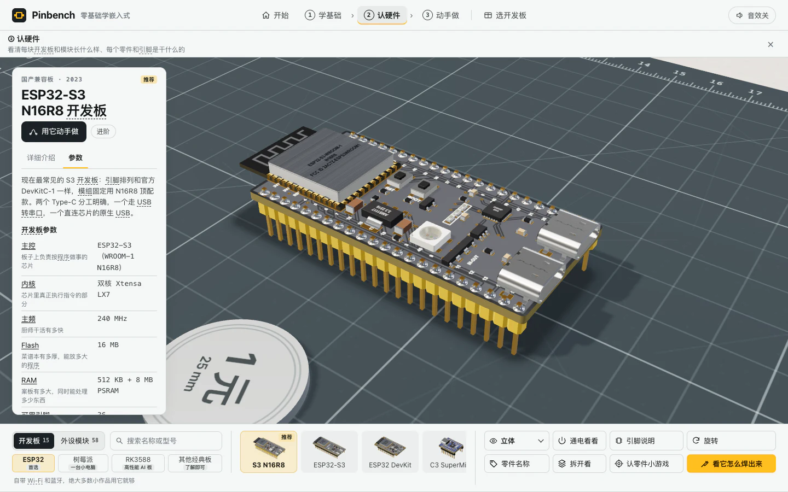
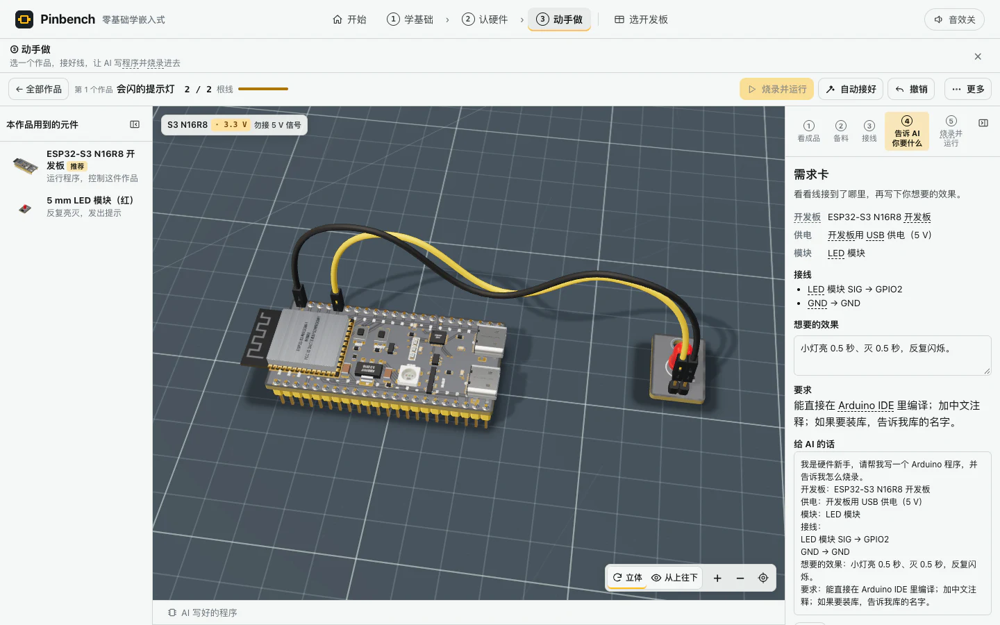
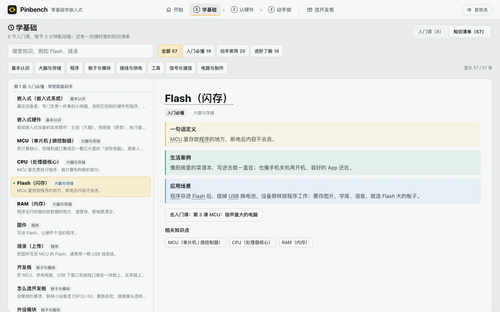

# Pinbench · 零基础学嵌入式

Pinbench 是一套在浏览器里学习嵌入式硬件的 3D 入门课程。你可以旋转开发板观察零件，照着清单接线，调整作品的行为，再用模拟烧录查看结果。课程以 **ESP32-S3 N16R8** 为主，从一盏会闪的灯开始，逐步做出小夜灯、倒车雷达和桌面温湿度计。

[在线体验](https://pinbench-3d-workshop.vercel.app) · [开始入门课](https://pinbench-3d-workshop.vercel.app/#learn) · [打开作品列表](https://pinbench-3d-workshop.vercel.app/#lab) · [下载单文件 HTML](https://raw.githubusercontent.com/think2do/pinbench-3d-workshop/main/index.html)

## 从哪开始

| 入口 | 你可以做什么 |
| --- | --- |
| **开始** | 按六站路线走，浏览器记住已学课程、已查看硬件和已完成作品。 |
| **学基础** | 学完四章八课，边读课文边看 3D 演示，或者到知识清单里查术语和硬件。 |
| **认硬件** | 查看 15 块开发板和 58 个外设与配件，了解零件位置、引脚用途和组装过程。 |
| **动手做** | 从 8 个引导作品中挑一个练习，或进入 4 个找错挑战和自由搭建。 |
| **选开发板** | 从用途出发查看推荐，对比参数，或把所选板子带入自由搭建。 |

如果你是第一次接触硬件，点首页的「从零开始」。六站依次是认识嵌入式、认识大脑、认识板子和模块、学会接线、让 AI 帮你编程、做一个有用的小产品。最后一站可以选择倒车雷达或桌面温湿度计。

## 四章八节入门课

| 章节 | 课程 |
| --- | --- |
| 认识嵌入式 | 嵌入式是什么、嵌入式硬件由什么组成 |
| 认识大脑 | MCU：指甲盖大的电脑、固件和烧录 |
| 认识硬件 | 开发板：买来就能用的 MCU、外设模块：给板子装上感官和手脚 |
| 动手准备 | 接线三件套：电源、地、信号、让 AI 帮你写程序 |

每课都有一句定义、生活例子、工作步骤、应用场景、推荐清单、新手常踩的坑和可复制的 AI 提问模板。桌面可对照目录、课文和 3D 演示，手机使用按章分组的下拉目录。点击硬件推荐卡，可以在课程中预览对应模型，再回到刚才的演示。

## 认识硬件与选板

在「认硬件」里可以旋转、缩放和翻面，点零件看用途，打开引脚说明查看各脚能接什么。支持的板卡还可以用「通电看看」「拆开看」、组装演示和认零件小游戏观察结构与装配。外设与配件覆盖显示、灯光、传感器、电机、通信、声音、电源、输入和线材。

15 块开发板按 ESP32、树莓派、RK3588 和其他经典板四组整理。ESP32-S3 N16R8 是课程和入门作品使用的开发板，Arduino 与 STM32 也可查看和比较。选板页可以按用途填入推荐型号，参数名会链接到知识清单。主频、Flash 和 RAM 用厨房里的厨师、菜谱本和案板解释。

## 做出第一个作品

打开「会闪的提示灯」，按 **看成品 → 备料 → 接线 → 告诉 AI 你要什么 → 烧录并运行** 完成作品。可以自己连线，也可以用「自动接好」对照正确接法。需求卡会根据当前接线整理提示词，改需求后可查看对应的内置程序示例。

| 作品 | 可以观察的结果 |
| --- | --- |
| 会闪的提示灯 | 调整亮灭间隔，看灯闪得更快或更慢。 |
| 按一下就亮的台灯 | 操作按钮，看它怎样控制小灯。 |
| 天黑自动亮的小夜灯 | 改变环境亮度，观察灯何时点亮。 |
| 倒车雷达（靠近就报警） | 调整障碍物距离，观察报警。 |
| 桌面温湿度计 | 改变温度和湿度，观察屏幕读数。 |
| 旋钮调光灯 | 转动旋钮，观察灯的亮度变化。 |
| 会摇头的小摆件 | 调整舵机停顿时间，观察来回转动。 |
| 小车的轮子 | 看轮子正转、停下和反转。 |

4 个「找错挑战」分别练习小灯接反、少接地线、接错引脚和测距信号太强。接线时可查看检查提示，支持撤销。作品里的进阶工具可以测模拟电压并查看输出。自由搭建可自行选板、添加模块和布线，需求卡也会提示缺少的连接。

页面内的 AI 写程序和烧录均为教学演示，使用内置示例和模拟规则。需要为真实硬件写程序时，可以把需求卡里的提示词复制给常用 AI，再按手头的开发板与模块核对引脚、供电和依赖库。

## 查知识与看演示

知识清单有 **57 条知识条目**，可搜索，也可按入门必懂、动手常用、进阶了解筛选。每条用一句话定义、生活案例和应用场景解释，有的还关联入门课、硬件或作品。清单中可打开 **13 个独立的 3D 概念演示**，包括面包板、模拟信号、PWM 和 I²C。

## 离线使用与部署

在 GitHub 打开 [index.html](index.html)，点击 **Download raw file**，再用支持 WebGL 的现代浏览器双击打开。应用代码、Three.js r160、模型、样式和内容都内联在这个文件里，运行无需安装依赖。学习进度和自由搭建数据保存在当前浏览器的 `pinbench.*` 本地存储中。

仓库可直接作为静态站点部署。Vercel 配置位于 [vercel.json](vercel.json)。本地也可以在仓库目录运行 `python3 -m http.server 8080`，然后打开 [本地预览](http://localhost:8080)。

Pinbench 由 **Huang Xiyuan · 且曼学院** 创建，通过 **think2do** 开源，采用 [MIT 许可证](LICENSE)。
