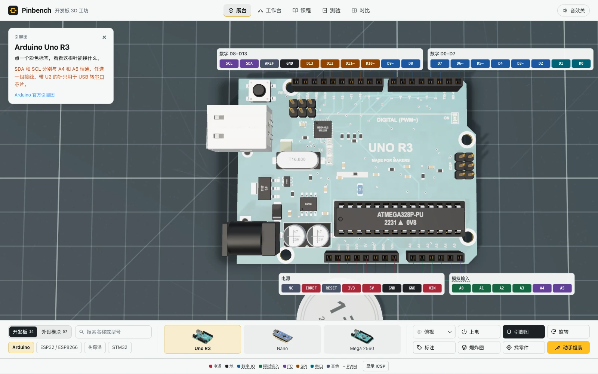
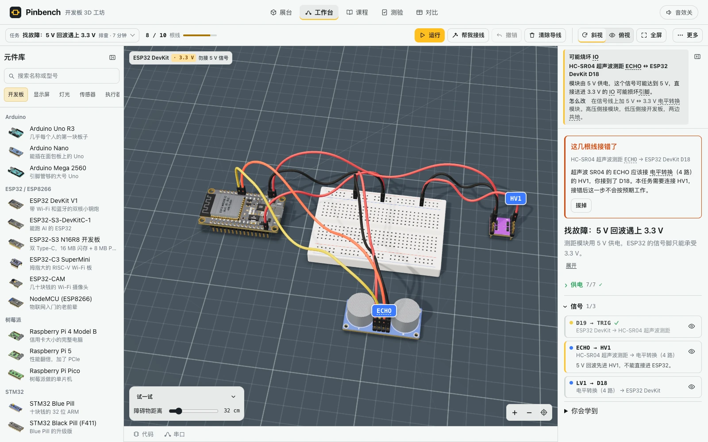
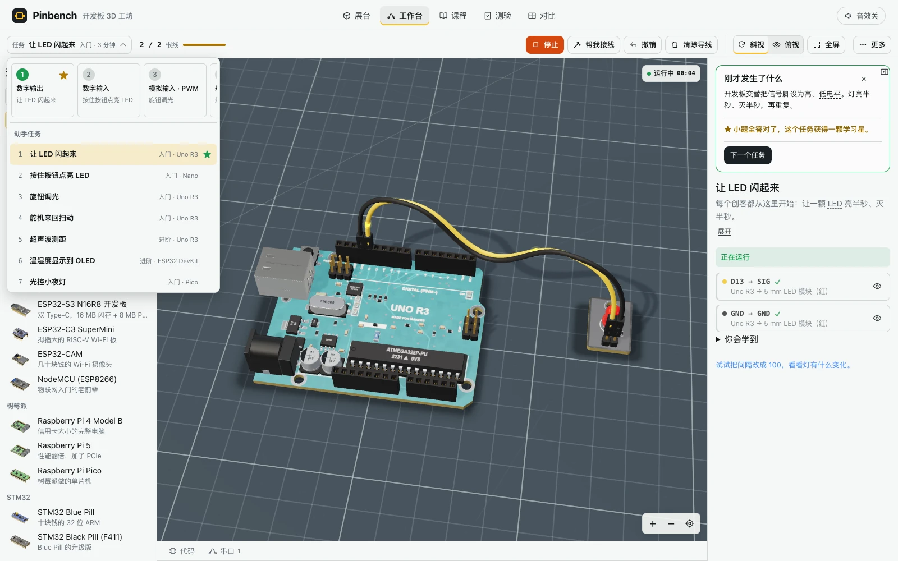

# Pinbench · 开发板 3D 工坊

**面向零基础的 3D 电路实验台：认零件、接电路、看结果，再学会找出接错的地方。**

Pinbench 把开发板、外设、接线和入门课程放进一个浏览器页面。你可以放大观察芯片与接口，亲手组装开发板，在面包板上接出第一个电路；运行后用滑块改变输入、用探针查看模拟电压，并把接线、代码和输出结果对应起来。

目前包含 **14 块开发板、57 个外设与配件、8 个引导实验、4 个找故障关卡、24 道任务后小题，以及 10 道带解析与跳转入口的测验题**。应用是单个 HTML，Three.js r160 已内联，可下载后离线双击打开，无需安装开发环境。

创建人：**Huang Xiyuan** · **且曼学院**  
开源组织：**think2do** · **MIT License**

[在线体验](https://pinbench-3d-workshop.vercel.app) · [下载单文件 HTML](https://github.com/think2do/pinbench-3d-workshop/blob/main/index.html) · [开发板清单](#14-块开发板) · [引导实验](#8-个引导实验) · [开源许可](LICENSE)

[](https://pinbench-3d-workshop.vercel.app)

## 核心功能一览

| 你想解决的问题 | 在 Pinbench 里怎么做 |
| --- | --- |
| 不知道板子上的零件叫什么 | 旋转、放大、翻面看 3D 模型；点击标注读用途，用爆炸图看装配位置 |
| 不知道一根引脚能接什么 | 打开按排座分组的彩色引脚图，查看名称、用途和限制；对照模块的引脚说明与最小接线示例 |
| 想先接一个能动的电路 | 按任务清单逐根接线，或点「帮我接线」；运行后看 LED、舵机、屏幕和电机的变化 |
| 接好了却没有反应 | 查看错线和电气检查，使用「测电压」查看引脚、孔或导线；观察元件的完整回路 |
| 看懂了，还想自己改一改 | 调参数、换合格的信号脚、自由搭建；示例代码随支持的参数和接线更新 |
| 想知道自己是否真正理解 | 按学习路线做实验，完成小题拿学习星，再挑战预置错误的「找故障」关卡 |

## 适合谁使用

| 人群 | 可以用它做什么 | 推荐从哪里开始 |
| --- | --- | --- |
| 完全没接触过硬件的新手 | 先认识供电、地线和信号，再练习接通一个完整回路 | 在展台看 Uno R3，然后做「让 LED 闪起来」 |
| 学生与自学者 | 把数字输入、模拟输入、PWM、I²C 和实际接线对应起来 | 依次做按键点灯、旋钮调光、测距和温湿度显示 |
| 教师、助教与创客社团 | 投屏讲解结构和接线，带学生动手，随后用小题和故障关卡检查理解 | 用引脚图讲接线，用任务和探针解释电流去路与回路 |
| 准备做实物原型的创客 | 对照尺寸、接口、逻辑电平和引脚资源，预演常见外设组合 | 用「我想做…」选型助手和对比表选板，再进入自由搭建 |

## 认识开发板：3D 展台、引脚图与组装

**观察结构。** 展台支持旋转、缩放、斜视、俯视、正视和翻面。点击零件能查看它的名称和用途；背面零件会带标记并切到背面。爆炸图将器件分层展开，用虚线标出焊盘原位；「找零件」帮助练习识别芯片、接口和排针。桌面上的 25 mm 一元硬币与板身尺寸提供大小参照，已有路径数据的板子还可播放「上电」演示。

**看懂引脚。** 引脚图保持板子的正向摆放，按真实排座分组。以 Uno 为例，标签分为「电源」「模拟输入」「数字 D0–D7」「数字 D8–D13」，ICSP 默认收起，需要时再展开。电源、地、数字 IO、模拟输入、I²C、SPI 和串口使用不同颜色，PWM 引脚带 `~` 标记；点标签可看“能做什么”和“不能做什么”。



**亲手组装。** 在托盘里选取零件，把它放回电路板；观察烙铁接触、焊锡长出与凝固的动画。步骤说明会区分直插件和贴片件，卡住时可以用提示或自动放置。熟悉后可切到挑战模式。这个过程帮助理解零件的位置、安装方向与焊点关系。


## 动手接线：3D 桌面就是实验台

工作台分为元件库、3D 桌面、任务面板，以及可展开的代码／串口抽屉。元件库与展台共用名称和型号搜索，开发板、外设都有缩略图，可以点击添加或拖到桌面。左右面板可收起，保留更大的观察空间。

- **按清单接线。** 每一步显示两端引脚、设备名和一句解释；点击眼睛按钮可定位。超过 5 根线时分为「供电」「信号」，完成的组自动折叠成一行，方便继续下一步。
- **一孔只插一根线。** 面包板的孔可以接线，同一列 5 孔相通，中央凹槽两侧分开，电源轨用于分线。悬停可查看相通的孔；支持的朝下排针开发板可吸附插到面包板上。
- **更容易点准。** 引脚挤在一起时弹出候选菜单；双击元件可拉近，双击空白恢复全景。触屏可长按引脚放大查看。加线、删线、移动元件等操作支持撤销／重做。
- **改变输入，看结果。** 按住按钮、拧旋钮、调环境亮度、温湿度或障碍物距离，看灯光、舵机、屏幕、蜂鸣器、电机和串口读数如何响应。
- **改参数，也改代码。** 支持调节闪灯间隔、舵机每度停顿、报警距离、开灯阈值和电机正转时长。支持备选引脚的任务中，接到合格的脚也算完成，示例程序会同步换成实际引脚号。


**自由搭建**可以选择开发板和外设，自行布置与接线。支持的行为会列在「运行检查」里；没有响应的元件会说明缺供电、缺地线、信号没接到 IO、I²C 接反或引脚不适合等原因。代码区给出根据接线自动生成的示例程序，串口区显示教学仿真的输出。

## 找到错误：电气检查、测电压与完整回路

在任务里接错线时，导线会标红，面板说明接到了哪里、应该接哪里，并提供「拔掉」。电气检查覆盖常见短路、电源接反、模块供电过压、3.3 V IO 接收 5 V 信号、直接用 IO 带动大电流负载、缺地线和直插 LED 没串电阻等情况；根据严重程度给出提示或阻止运行。

工作台「更多 → 测电压」可查看引脚、面包板孔或导线的**模拟电压**，显示 0 V、3.3 V、5 V、约 6 V 或悬空，以及高／低电平、在跳变、PWM 占空比等状态。例如运行闪灯实验后点 D13，会解释它每半秒在 0 V 与 5 V 之间切换。运行时点选负载，还能高亮其供电和回流路径，配合导线上的光点观察回路。



### 4 个找故障关卡

每关预先放好器材和线路，藏着一个需要修正的问题。正确修复并观察到运行效果后才过关，小结会解释这类错误在实物里的后果。

| 关卡 | 要找的问题 | 学会什么 |
| --- | --- | --- |
| LED 为什么不亮 | 直插 LED 正负极接反 | 分辨极性，并保持串联限流电阻 |
| 少了哪根线 | LED 模块缺 GND | 供电和回路都需要接好 |
| 程序和接线对不上 | 线接 D12，固定程序控制 D13 | 对照程序里的引脚号与实际接线 |
| 5 V 回波遇上 3.3 V | HC-SR04 的 ECHO 直连 ESP32 IO | 区分模块供电与信号电平，用电平转换后再接入 |

## 从实验到理解：学习路线、小题与课程

任务选单顶部有 **8 个学习节点**，从数字输出、数字输入，逐步走到模拟输入、PWM、舵机、测距、I²C 和电机驱动。完成的任务会点亮；实验运行满 4 秒后，在任务面板里出现「刚才发生了什么」小结，随后是针对这次电路的 2 道小题。答错可以看解释并重试，全部答对获得学习星。4 个故障关卡也各有 2 道小题，合计 24 题。



「课程」整理每块板的参数、要点、常见错误和适用场景。「测验」有 10 道独立题，答完可点击「去 3D 里看看」打开对应板子并高亮零件，或直接进入相关实验。「对比」支持按用途推荐 1–2 块板，再自行添加比较对象。


遇到 GPIO、PWM、ADC、I²C、逻辑电平等词，可以点击或悬停虚线词，查看一句解释和生活类比。同一段落、列表项或表格中的重复词只标一次，课程页每屏最多显示 8 个提示词。首次进入展台、工作台或面包板任务时，也有可跳过的操作引导。

手机上使用底部导航切换「展台／工作台／课程／测验／对比」。任务抽屉默认半屏，画布会重新取景，把下一根线的引脚标签留在可见区域。任务完成记录、学习星、最后访问页面、选中器材和自由搭建布局保存在当前浏览器本地。

## 14 块开发板

| 系列 | 型号 | 建议在工坊里重点观察 |
| --- | --- | --- |
| Arduino | **Arduino Uno R3** | 可拔插的 ATmega328P、USB-B 和数字／模拟引脚；多数入门接线实验从这里开始 |
| Arduino | **Arduino Nano** | 紧凑板形和两侧排针；与 Uno 对照观察同系列主控的不同布局 |
| Arduino | **Arduino Mega 2560** | 扩展的数字口、模拟口和硬件串口；适合对照多外设项目需要的引脚资源 |
| ESP32 / ESP8266 | **ESP32 DevKit V1** | 无线模组和 3.3 V 引脚；温湿度显示实验使用这块板连接 DHT11 和 OLED |
| ESP32 / ESP8266 | **ESP32-S3-DevKitC-1** | 双 USB-C 接口、无线模组及原生 USB 和串口的区别 |
| ESP32 / ESP8266 | **ESP32-S3 N16R8 开发板** | 双 USB-C 和 N16R8 模组；在课程中了解 16 MB 闪存与 8 MB PSRAM 的配置 |
| ESP32 / ESP8266 | **ESP32-C3 SuperMini** | 小尺寸板形、USB-C 和陶瓷天线；对比紧凑联网板的引脚取舍 |
| ESP32 / ESP8266 | **ESP32-CAM** | 摄像头、存储卡槽和串口下载接线；认识带摄像头模组的布局 |
| ESP32 / ESP8266 | **NodeMCU（ESP8266）** | 板上 D 编号与 GPIO 的对应关系、A0 模拟口及 USB 转串口电路 |
| Raspberry Pi | **Raspberry Pi 4 Model B** | USB、网口、Micro-HDMI 和 40 针排针；用爆炸图观察单板电脑的结构 |
| Raspberry Pi | **Raspberry Pi 5** | PCIe、通用 MIPI 接口和 RP1；适合与 Pi 4 并排比较 |
| Raspberry Pi | **Raspberry Pi Pico** | RP2040、BOOTSEL 和模拟输入脚；用 MicroPython 示例学习光控小夜灯 |
| STM32 | **STM32 Blue Pill** | STM32F103、启动跳线和 SWD 接口；观察启动设置与调试接口 |
| STM32 | **STM32 Black Pill（F411）** | STM32F411、USB-C 和启动／复位按键；对比两块 STM32 板的接口差异 |

如果刚开始学接线，建议先用 **Uno R3** 或 **Nano**；想练习 3.3 V 传感器和 I²C，可以选 **ESP32 DevKit V1**；想用 MicroPython 理解模拟输入，可以从 **Pico** 的光控任务入手。Pi 4 / Pi 5 是可以运行 Linux 的单板电脑，Pico 是微控制器板，适合在「对比」中一起看。

## 57 个外设与配件

模块页提供用途、供电、逐脚说明和最小接线示例，可复制配套示例代码；面包板、杜邦线、跳线盒等配件则说明怎么用和常见错误。器材库包含原有 56 件，加上用于 LED 限流实验的 **220 Ω 电阻**。

| 分类 | 数量 | 部分器材 |
| --- | ---: | --- |
| 显示屏 | 8 | SSD1306 OLED、LCD1602、TFT、IPS、LED 点阵、四位数码管 |
| 灯光 | 7 | 红／绿 LED 模块、直插 LED、RGB LED、交通灯、WS2812 灯条和灯环 |
| 传感器与摄像头 | 7 | HC-SR04、VL53L0X、DHT11、光敏模块、PIR、MPU6050、OV7670 |
| 电机与执行器 | 7 | SG90、MG996R、TT 减速电机、L298N、继电器和风扇 |
| 无线与通信 | 7 | ESP-01S、HC-05、NRF24L01+、LoRa、RS485、USB 转 TTL、电平转换 |
| 声音 | 5 | 蜂鸣器、小喇叭、MAX98357A、INMP441、声音传感器 |
| 电源 | 5 | AA 和 18650 电池盒、LM2596、TP4056、MB102 面包板电源 |
| 开关与输入 | 6 | 按钮、电位器、拨动开关、旋转编码器、摇杆、薄膜键盘 |
| 线材与面包板 | 5 | 220 Ω 电阻、400 孔和 830 孔面包板、杜邦线、跳线盒 |

## 8 个引导实验

| 实验 | 主要器材 | 你可以观察与练习什么 |
| --- | --- | --- |
| **让 LED 闪起来** | Uno R3 + LED 模块 | 接通数字输出与地线；把亮灭间隔从 500 ms 改成 100 ms，看代码和灯同步变快 |
| **按住按钮点亮 LED** | Nano + 按钮 + LED + 面包板 | 按钮把输入状态交给开发板，再由程序控制 LED |
| **旋钮调光** | Uno R3 + 电位器 + LED + 面包板 | 看模拟输入读数如何通过 PWM 改变亮度 |
| **舵机来回扫动** | Uno R3 + SG90 | 区分供电线和控制线，调节每度停顿观察速度变化 |
| **超声波测距** | Uno R3 + HC-SR04 + 蜂鸣器 + 面包板 | 理解 TRIG / ECHO，改变距离并调整报警阈值 |
| **温湿度显示到 OLED** | ESP32 + DHT11 + OLED + 面包板 | 用 3.3 V 供电、认识 SDA / SCL，查看屏幕和串口数据 |
| **光控小夜灯** | Pico + 光敏模块 + LED + 面包板 | 用 MicroPython 示例理解模拟读数与开灯阈值 |
| **驱动小车轮子** | Uno R3 + L298N + TT 电机 + 电池盒 + 面包板 | 认识独立电机供电、逻辑供电与共地，观察正转、停转和反转 |

电机任务使用 4 节 AA 电池盒（约 6 V）给电机供电，已移除 L298N 模块的 5V-EN 跳线帽，由 USB 供电的 Uno 向驱动板逻辑部分提供 5 V。

## 第一次使用，建议这样走

1. 在「展台」选择 **Uno R3**，点几个零件，再打开「引脚图」找到 5V、GND 和 D13。
2. 进入「工作台」，选择 **让 LED 闪起来**。可以先点「帮我接线」，观察 D13 → SIG、GND → GND 两根线，再点「运行」。
3. 打开「测电压」点 D13；去代码抽屉把亮灭间隔改成 100，观察灯和示例程序一起变化。
4. 回答小结里的两道题获得第一颗星，再做 **按住按钮点亮 LED**，或挑战 **找故障：少了哪根线**。

## 仿真范围

Pinbench 是面向入门教学的交互演示。3D 模型、接线网络、电气检查和外设动作帮助理解“输入—程序行为—输出”；点击运行调用的是内置教学规则，**不会编译或执行任意 Arduino / MicroPython 程序，也不提供完整的微控制器或 SPICE 电路仿真**。

探针显示的是模拟器推导的电压和状态，导线光点用于观察信号，不是精密电流测量。器材库中的模型与接线说明覆盖面比可组合的实时仿真更广，具体互动效果以任务和「运行检查」为准。把示例用于实物时，需要按手头板卡与模块的实际规格核对引脚、电源、电平和依赖库。

## 下载与本地运行

下载仓库中的 [`index.html`](index.html)（在 GitHub 文件页点 **Download raw file**），用支持 WebGL 的现代浏览器直接打开即可。需要分享给朋友时，只转发这一个 HTML 文件就够了。

应用代码、Three.js r160、3D 模型、样式与数据全部在 `index.html` 中；启动时不依赖 CDN、在线字体或图片。README 配图仅用于项目介绍，不是应用运行依赖。资料链接和在线体验链接在主动打开时需要联网。

也可以在目录里启动静态服务：

```sh
python3 -m http.server 8080
```

然后访问 `http://localhost:8080`。没有 npm 安装或打包步骤。

完成记录与桌面布局保存在当前浏览器的 `pinbench.*` 本地存储中，不会自动同步到另一台设备；本地存储不可用时，页面仍可正常运行。

## 部署与源码组织

项目部署为普通静态站点。Vercel 使用仓库根目录，Framework Preset 选择 **Other**，不设置构建或安装命令，输出目录为 `.`；仓库已包含 `vercel.json`。

应用保持单文件结构，通过 `__m[...]` 注册表组织模块：

| 模块 | 负责内容 |
| --- | --- |
| `core`、`parts`、`board` | 渲染基础、元器件与 PCB |
| `boards-arduino`、`boards-esp`、`boards-pi-stm` | 14 块开发板模型 |
| `modules`、`modules2` | 外设与配件模型 |
| `content` | 器材资料、引脚说明、术语、任务、小题与测验 |
| `desk`、`stage` | 桌面道具、展台、引脚图与组装 |
| `bench` | 接线、任务、教学仿真、诊断与代码示例 |
| `main` | 页面路由、课程、测验与对比 |

## 开源许可

本项目由 **Huang Xiyuan · 且曼学院** 创建，在 [think2do/pinbench-3d-workshop](https://github.com/think2do/pinbench-3d-workshop) 开源，采用 [MIT 许可证](LICENSE)。欢迎用于学习、课堂演示与二次开发，也欢迎提交问题和改进建议。

Copyright (c) 2026 Huang Xiyuan。
