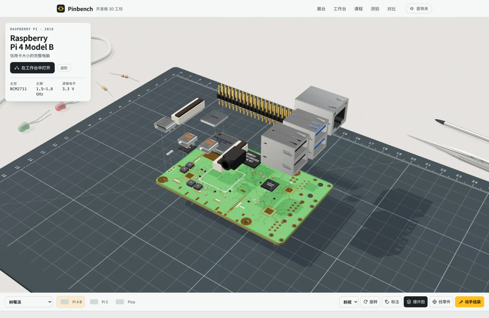
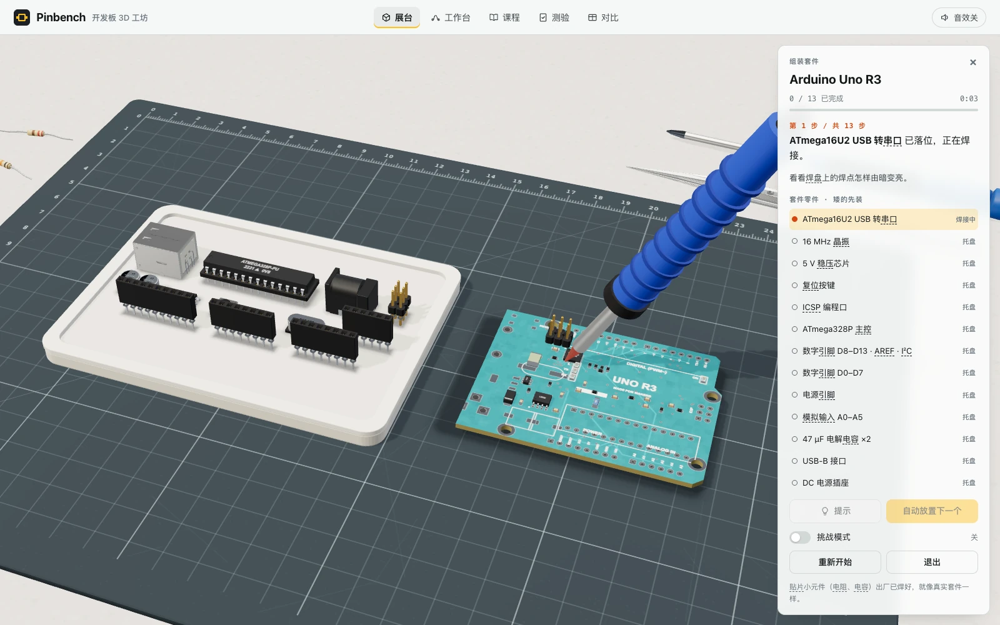
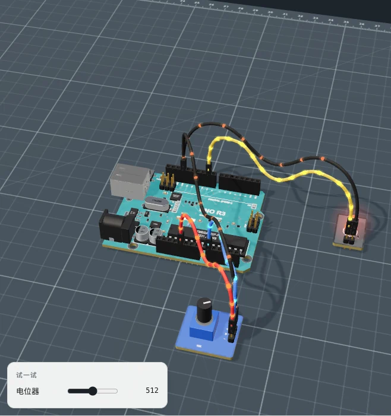
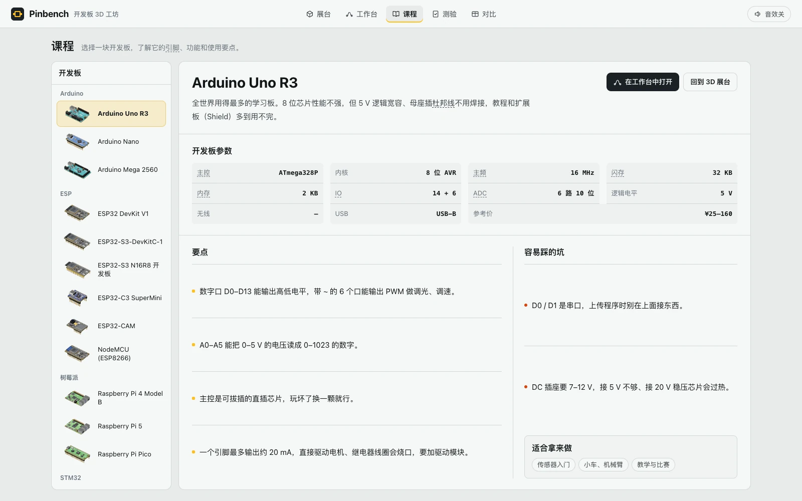

# Pinbench · 开发板 3D 工坊

**从认出一块开发板上的零件，到自己接好并运行第一个电路。**

Pinbench 是一个开源的嵌入式硬件学习工作台。打开浏览器，就能旋转和拆解开发板，在虚拟托盘里选取零件、观察焊接过程，再把开发板和外设放上工作台，用杜邦线连接引脚。电路运行后，可以改变输入，观察灯光、屏幕、电机和串口读数如何响应。

器材库目前包含 **4 个系列、14 块开发板、56 个外设与配件**，并配有 **8 个接线实验**和 **10 道带解析的测验题**。

创建人：**Huang Xiyuan** · **且曼学院**

[打开在线工坊](https://pinbench-3d-workshop.vercel.app) · [查看开发板清单](#14-块开发板) · [查看接线实验](#8-个引导实验) · [MIT 许可证](LICENSE)

[](https://pinbench-3d-workshop.vercel.app)

*新版 3D 展台。可以查看开发板尺寸，旋转模型，也可以从底栏打开引脚图、爆炸图或动手组装。*

## 适合谁使用

| 人群 | 可以用它做什么 | 推荐从哪里开始 |
| --- | --- | --- |
| 没接过电路的初学者 | 先认识主控、供电和信号引脚，再练习接一条完整的回路 | 在展台看 Arduino Uno R3，然后做「让 LED 闪起来」 |
| 学生与自学者 | 把 GPIO、模拟输入、PWM、I²C 等概念和实际接线、输出结果对应起来 | 从按键点灯和旋钮调光开始，再做测距或温湿度显示 |
| 教师、助教与创客社团 | 在课堂上投屏演示开发板结构、接线顺序和常见错误，让学生跟做同一个实验 | 用爆炸图讲零件位置，用任务清单带着接线，最后做测验 |
| 准备搭实物原型的创客 | 在买板或接线前比较尺寸、接口、逻辑电平和引脚资源，并预演常见外设组合 | 在「对比」里选三块板，再用「自由搭建」试接 LED、屏幕或舵机 |

## 工坊里可以做什么

### 1. 看懂开发板上每个零件的位置

在「展台」中按系列选择开发板，或切到外设分类。可以旋转、缩放、俯视和翻面，观察芯片、USB 接口、排针、稳压器等器件。打开「标注」后，点击零件可以查看名称和用途；打开「爆炸图」后，零件会分层展开，并用虚线标出原来的位置。熟悉一块板之后，还可以用「找零件」测试自己能否认出对应器件。

### 2. 亲手组装，观察焊点怎么形成

点击「动手组装」，从托盘里找出当前步骤所需的芯片或接口，放回板上对应的位置。焊接演示会显示烙铁接触焊盘、焊锡成形和凝固的过程。卡住时可用提示或自动放置；熟悉流程后，可以开挑战模式，在没有位置提示的情况下完成组装。



*Arduino Uno 组装演示：从左侧托盘找零件，按右侧清单完成装配。*

### 3. 在工作台接线，改变输入并观察输出

- **按实验步骤接线。** 任务面板列出每根线的两端和用途。点击两个引脚即可连接；找不到引脚时，可以在桌面高亮位置，或使用「帮我接线」。任务要求的线路接齐后才能运行。常见的电源引脚与 GND 短路会触发提示。
- **动手改变条件。** 按住按钮、调节电位器或改变环境亮度，观察 LED 的变化；拖动距离滑块看超声波测距和蜂鸣器报警；调节温湿度，看 OLED 和模拟串口读数更新。
- **观察信号走向。** 在支持的连线上，运行时会显示电源和信号脉冲。配合波环、屏幕显示和器件动作，可以看清输入、接线与输出之间的关系。
- **试试自由搭建。** 自选开发板和外设，拖动器件、调整布局，再连接电源、地线与信号线。例如用按钮控制 LED，或用电位器控制舵机角度。工作台按已有的器件演示规则响应接线。
- **把接线与代码对上。** 每个任务提供可复制的 Arduino C++ 或 MicroPython 示例。自由搭建可根据引脚连接生成基础 I/O 代码模板；运行时可在「串口」页查看模拟输出。



*「让 LED 闪起来」实验。工具栏显示接线进度，右侧可以查看每根线的两端并定位引脚。*

### 4. 学习、测验和选板



「课程」为每块板整理了主控、接口、电平、使用注意事项和适用场景。「对比」可以任选三块板并排看主频、存储、GPIO、ADC、无线和 USB 等参数。「测验」有 10 道带答案解析的题目，帮助检查对芯片、引脚、电平和接口的理解。

## 14 块开发板

| 系列 | 型号 | 建议在工坊里重点观察 |
| --- | --- | --- |
| Arduino | **Arduino Uno R3** | 可拔插的 ATmega328P、USB-B 和数字／模拟引脚；多数入门接线实验从这里开始 |
| Arduino | **Arduino Nano** | 紧凑板形和两侧排针；与 Uno 对照观察同系列主控的不同布局 |
| Arduino | **Arduino Mega 2560** | 扩展的数字口、模拟口和硬件串口；适合对照多外设项目需要的引脚资源 |
| ESP32 / ESP8266 | **ESP32 DevKit V1** | 无线模组和 3.3 V 引脚；温湿度显示实验使用这块板连接 DHT11 和 OLED |
| ESP32 / ESP8266 | **ESP32-S3-DevKitC-1** | 双 USB-C 接口、无线模组及原生 USB 和串口的区别 |
| ESP32 / ESP8266 | **ESP32-S3 N16R8 开发板** | 双 USB-C 和 N16R8 模组；在课程中了解 16 MB 闪存与 8 MB PSRAM 的配置 |
| ESP32 / ESP8266 | **ESP32-C3 SuperMini** | 小尺寸板形、USB-C 和陶瓷天线；对比紧凑联网板的引脚取舍 |
| ESP32 / ESP8266 | **ESP32-CAM** | 摄像头、存储卡槽和串口下载接线；认识带摄像头模组的布局 |
| ESP32 / ESP8266 | **NodeMCU（ESP8266）** | 板上 D 编号与 GPIO 的对应关系、A0 模拟口及 USB 转串口电路 |
| Raspberry Pi | **Raspberry Pi 4 Model B** | USB、网口、Micro-HDMI 和 40 针排针；用爆炸图观察单板电脑的结构 |
| Raspberry Pi | **Raspberry Pi 5** | PCIe、通用 MIPI 接口和 RP1；适合与 Pi 4 并排比较 |
| Raspberry Pi | **Raspberry Pi Pico** | RP2040、BOOTSEL 和模拟输入脚；用 MicroPython 示例学习光控小夜灯 |
| STM32 | **STM32 Blue Pill** | STM32F103、启动跳线和 SWD 接口；观察启动设置与调试接口 |
| STM32 | **STM32 Black Pill（F411）** | STM32F411、USB-C 和启动／复位按键；对比两块 STM32 板的接口差异 |

如果刚开始学接线，建议先用 **Uno R3** 或 **Nano**；想练习 3.3 V 传感器和 I²C，可以选 **ESP32 DevKit V1**；想用 MicroPython 理解模拟输入，可以从 **Pico** 的光控任务入手。Pi 4 / Pi 5 是可以运行 Linux 的单板电脑，Pico 是微控制器板，适合在「对比」中一起看。

## 56 个外设与配件

器材按用途分组。选中模块可以查看名称、用途、接口和供电说明，再把需要的器件放进工作台。

| 分类 | 数量 | 部分器材 |
| --- | ---: | --- |
| 显示屏 | 8 | SSD1306 OLED、LCD1602、TFT、IPS、LED 点阵、四位数码管 |
| 灯光 | 7 | 红／绿 LED 模块、直插 LED、RGB LED、交通灯、WS2812 灯条和灯环 |
| 传感器与摄像头 | 7 | HC-SR04 超声波、VL53L0X 激光测距、DHT11、光敏模块、PIR、MPU6050、OV7670 |
| 电机与执行器 | 7 | SG90、MG996R、TT 减速电机、L298N、继电器和风扇 |
| 无线与通信 | 7 | ESP-01S、HC-05、NRF24L01+、LoRa、RS485、USB 转 TTL、电平转换 |
| 声音 | 5 | 蜂鸣器、小喇叭、MAX98357A、INMP441、声音传感器 |
| 电源 | 5 | AA 和 18650 电池盒、LM2596 降压、TP4056 充电、MB102 面包板电源 |
| 开关与输入 | 6 | 按钮、电位器、拨动开关、旋转编码器、摇杆、薄膜键盘 |
| 线材与面包板 | 4 | 400 孔和 830 孔面包板、杜邦线、跳线盒 |

## 8 个引导实验

| 实验 | 使用的器材 | 你可以观察与练习什么 |
| --- | --- | --- |
| **让 LED 闪起来** | Uno R3 + LED | 接好 D13 和 GND，观察数字引脚切换高低电平时 LED 周期性亮灭 |
| **按住按钮点亮 LED** | Nano + 按钮 + LED | 给按钮接电源、地线和信号线，体验数字输入如何控制数字输出 |
| **旋钮调光** | Uno R3 + 电位器 + LED | 拧动旋钮，看模拟输入读数和 LED 亮度如何随 PWM 改变 |
| **舵机来回扫动** | Uno R3 + SG90 | 接好供电和控制信号，看舵机在不同角度之间往返 |
| **超声波测距** | Uno R3 + HC-SR04 + 蜂鸣器 | 改变虚拟障碍物距离，理解 TRIG / ECHO，并观察近距离报警 |
| **温湿度显示到 OLED** | ESP32 DevKit V1 + DHT11 + OLED | 调整温度和湿度，观察 OLED 及串口输出，认识 I²C 的 SDA / SCL |
| **光控小夜灯** | Pico + 光敏模块 + LED | 调低环境亮度，看 LED 何时亮起，理解 ADC 读数与阈值判断 |
| **驱动小车轮子** | Uno R3 + L298N + TT 电机 + 电池盒 | 移除 5V-EN 跳线帽，电池盒给电机供电，Uno 的 5 V 给驱动板逻辑供电。连接共地后观察电机正转、停转和反转 |

**第一次打开时：** 在展台选 Uno R3，打开爆炸图认一认芯片和排针；然后进入「工作台」选择「让 LED 闪起来」，接好 D13 → SIG、GND → GND，点「运行」。接着做「旋钮调光」，把输入、输出和代码连起来理解。

## 仿真范围

Pinbench 的 3D 模型用于认识结构和练习装配。点击「运行」会启动浏览器内置的教学仿真；代码页提供对应示例和基础模板。外设目录覆盖模型、引脚和用途介绍，互动效果随任务和器件而异。导线脉冲是信号状态的可视化，动画时间经过调整以便观察。做实物实验时，仍需根据手头板卡和模块的资料核对引脚、供电和电平。

## 本地运行与部署

应用代码、模型、样式和数据都在单文件 `index.html` 中。用支持 WebGL 的现代浏览器直接打开，或在仓库目录启动静态服务：

```sh
python3 -m http.server 8080
```

然后访问 `http://localhost:8080`。Three.js r160 已内联到 HTML，双击打开时也可以离线使用。静态站点无需构建。部署到 Vercel 时使用仓库根目录，Framework Preset 选择 Other。

## 开源许可

本项目采用 [MIT 许可证](LICENSE) 开源。Copyright (c) 2026 Huang Xiyuan。
