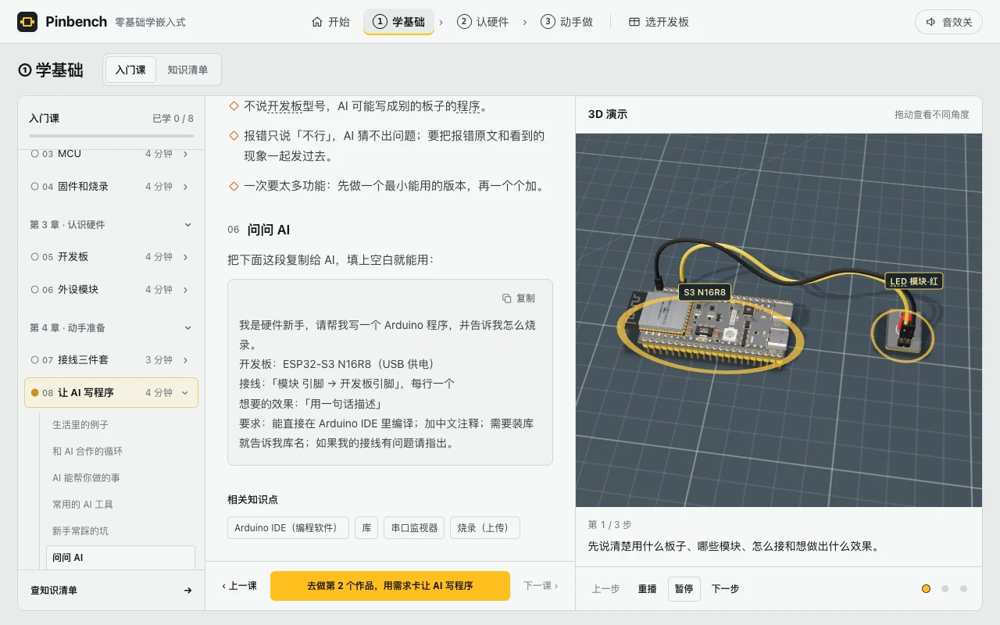

# Pinbench · 零基础学嵌入式

Pinbench 是一个开源的 3D 嵌入式学习工坊。你可以先看懂开发板和电路，再在浏览器里接线、运行作品，观察信号和输出。

[在线体验](https://pinbench-3d-workshop.vercel.app) · [开始入门课](https://pinbench-3d-workshop.vercel.app/#learn) · [下载单文件 HTML](https://github.com/think2do/pinbench-3d-workshop/blob/main/index.html) · [MIT 许可证](LICENSE)

## 从入门到动手

| 入口 | 可以做什么 |
| --- | --- |
| **学基础** | 从 8 节入门课认识嵌入式硬件、程序和接线，边读边看 3D 演示，也可以查阅 57 条知识。 |
| **认硬件** | 旋转观察 15 块开发板和 58 个外设与配件，查看引脚和零件说明，体验爆炸视图、拆装与焊接演示。 |
| **动手做** | 用 ESP32-S3 N16R8 完成 8 个作品，从会闪的提示灯做到倒车雷达、温湿度计和小车驱动。也可以自由接线，或用 4 个找错挑战练习排查。 |
| **选开发板** | 对比 ESP32、树莓派、RK3588、Arduino 和 STM32 等开发板，按用途挑选。 |

接线时可以自动连接、逐根核对或撤销。运行后可以调整输入、用探针查看模拟电压，并对照接线、代码和输出。电气检查会提示短路、电压不匹配和接线错误。

## v4.1 更新

- 入门课按 4 章组织，章节和每课的小节目录都能独立展开或收起。
- 课程目录用细边框区分当前课和小节，流程改为纵向步骤。
- “问问 AI”的复制按钮有独立位置，复制会保留模板里的换行。
- 支持桌面和手机浏览。桌面可独立滚动课文，3D 演示和底部操作栏保持可见。

## 入门课目录

| 章 | 课程 |
| --- | --- |
| 认识嵌入式 | 嵌入式是什么、由什么组成 |
| 认识大脑 | MCU、固件和烧录 |
| 认识硬件 | 开发板、外设模块 |
| 动手准备 | 接线三件套、让 AI 写程序 |

每课先用一句话介绍概念，再给出生活例子、工作步骤、应用场景、推荐器材、新手常见问题和可复制的 AI 提示词。相关知识条目可以从课文直接打开。

## 开发板

| 系列 | 开发板 |
| --- | --- |
| ESP32 | ESP32-S3 N16R8、ESP32-S3、ESP32、ESP32-C3、ESP32-CAM、NodeMCU |
| 树莓派 | Raspberry Pi 5、Raspberry Pi 4、Pico |
| RK3588 | RK3588 开发板 |
| 其他经典板 | Arduino Uno、Nano、Mega、STM32 Blue Pill、Black Pill |

外设库包含显示屏、LED、按钮、传感器、舵机、电机、供电和接线配件。你可以打开器件详情，再把它放到实验桌上。

## 八个作品

| 作品 | 能看到什么 |
| --- | --- |
| 会闪的提示灯 | LED 按设定的间隔闪烁。 |
| 按一下就亮的台灯 | 按钮控制灯的状态。 |
| 天黑自动亮的小夜灯 | 光敏模块检测环境明暗，控制 LED。 |
| 倒车雷达 | 超声波模块测距，障碍物靠近时触发蜂鸣。 |
| 桌面温湿度计 | OLED 显示温湿度传感器读数。 |
| 旋钮调光灯 | 旋钮改变 LED 亮度。 |
| 会摇头的小摆件 | 舵机来回转动。 |
| 小车的轮子 | 电机驱动板控制电机转动。 |

找错挑战从已经接好的电路开始，让你排查 LED 接反、漏接地线、程序和接线不匹配，以及 5 V 回波接入 3.3 V 引脚的问题。

## 离线使用与部署

下载 [index.html](https://github.com/think2do/pinbench-3d-workshop/blob/main/index.html)，用支持 WebGL 的现代浏览器打开。Three.js r160 已内联，可以离线使用，无需安装依赖。学习记录和桌面布局存于当前浏览器。

项目也可作为静态站点部署。仓库中的 [vercel.json](vercel.json) 配置直接发布根目录，无需构建。

Pinbench 的 3D 模型和电气检查用于入门教学。作品运行使用内置演示规则，实际硬件的编译和烧录需要对应开发工具。

## 作者与许可

由 **Huang Xiyuan · 且曼学院** 创建，在 **think2do** 开源，采用 [MIT 许可证](LICENSE)。
